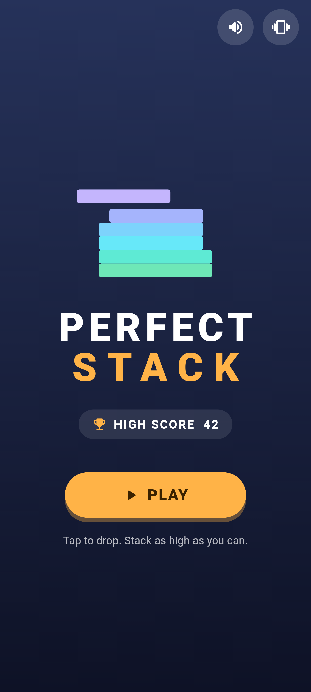
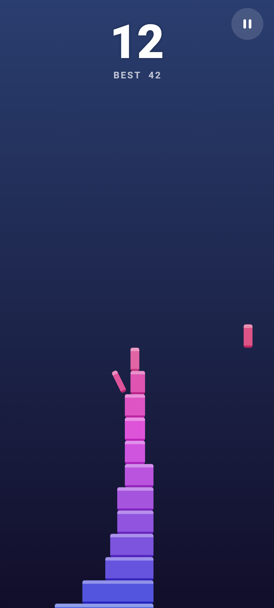
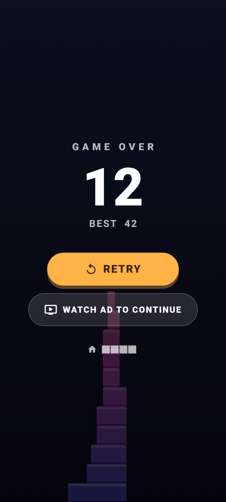

# Perfect Stack

A one-finger casual stacking game for Android, built with Flutter and Flame.
A block slides across the screen. Tap to drop it. Whatever hangs over the
edge is cut off. Miss completely and the run is over.

| Home | Gameplay | Game over |
|---|---|---|
|  |  |  |

## Features (MVP)

- Home screen with high score, sound and vibration toggles
- The block moves side to side. Tap anywhere to drop it (reacts on touch-down)
- Overlap is calculated exactly. The part that hangs over falls away as tumbling debris
- **Perfect** drops snap into place with a ripple, a floating "PERFECT ×N" label and a
  rising musical note. After 3 perfect drops in a row the block grows back a little
- Difficulty ramps up: speed rises with height, the "perfect" window shrinks,
  and each imperfect drop makes the block narrower
- The camera follows the tower and the background hue drifts as it grows
- Score "pop" animation, game-over panel with RETRY / WATCH AD TO CONTINUE / HOME
- Local high score, pause menu, correct Android back button behaviour
- Synthesized sound effects (no third-party assets) and haptic feedback
- Mocked ad layer (rewarded continue + interstitial frequency policy), ready for AdMob

## Architecture

```
lib/
  main.dart                  Portrait lock, edge-to-edge, service bootstrap
  app.dart                   MaterialApp + theme
  game/
    perfect_stack_game.dart  FlameGame: run lifecycle, input, camera, spawning
    components/              Block, debris, ripple, floating text, background
    systems/
      stack_logic.dart       Pure overlap/trim/perfect rules (unit tested)
      difficulty.dart        Tunable difficulty curve (DifficultyConfig)
  models/                    StackBlock, GamePhase, GameResult, BlockPalette
  screens/
    home_screen.dart
    game_screen.dart         Hosts GameWidget, HUD and overlays; back handling
    game_over_screen.dart
  services/
    ad_service.dart          AdService interface, Mock/Disabled impls,
                             InterstitialPolicy, AdManager facade
    storage_service.dart     shared_preferences wrapper (score, settings)
    sound_service.dart       flame_audio pools, failures swallowed
    haptic_service.dart      HapticFeedback, respects the setting
    app_services.dart        Holds all services and passes them to screens
  utils/app_colors.dart
  widgets/                   HUD, pause overlay, buttons, shared panels
assets/audio/                Generated WAVs (see tool/generate_sounds.py)
test/                        Logic tests + full widget-flow tests
```

Main design choices:

- **Flame renders, Flutter handles the UI.** The game only draws the world. Score,
  pause and game-over are normal Flutter widgets that react to
  `game.score` / `game.phase` (`ValueNotifier`s). This keeps UI simple to
  change and easy to test.
- **Fixed-width world.** All gameplay uses a 400-unit-wide world. The camera
  zoom fits it to the screen, so resizing, split screen and tablets never
  change the rules.
- **No timers.** The game-over delay is counted inside `update()`, so a
  restart can never leave a stray timer or listener behind. The game object is
  created once per `GameScreen`. Restart resets state in place.
- **Pure rules.** `StackLogic` and `DifficultyConfig` do not use Flame, so they are easy to
  unit test and tune.

### Adding future features

| Feature | Where it goes |
|---|---|
| Block skins / themes | New `BlockPalette` instances, passed to `PerfectStackGame(palette: ...)` |
| Difficulty modes | Named constructors on `DifficultyConfig` |
| Coins, missions, achievements, daily challenge | New keys/methods in `StorageService`, driven by `onGameOver` and `game.score` |
| Leaderboard | New `LeaderboardService` called from `GameScreen._handleGameOver` |
| Remove Ads purchase | Swap `MockAdService` for `DisabledAdService` in `AppServices` when purchased |
| Sound / vibration settings | Already stored. Add a settings screen that uses the existing toggles |

## Requirements

- Flutter **3.41+** stable (developed with 3.47, Dart 3.13)
- Android SDK + Android Studio (or command-line tools), a device or emulator

Check with `flutter doctor`.

## Run

```bash
cd perfect_stack
flutter pub get
flutter run            # debug, on a connected device/emulator
flutter run --release  # to judge real performance and game feel
```

## Build an APK / App Bundle

```bash
flutter build apk --release            # build/app/outputs/flutter-apk/app-release.apk
flutter build apk --split-per-abi      # smaller per-architecture APKs
flutter build appbundle --release      # build/app/outputs/bundle/release/app-release.aab (for Play)
```

Install an APK on a device: `flutter install` or `adb install build/app/outputs/flutter-apk/app-release.apk`.

### Release signing (needed for Google Play)

1. Create an upload keystore (one time, keep it safe and backed up):
   ```bash
   keytool -genkey -v -keystore ~/upload-keystore.jks -keyalg RSA \
     -keysize 2048 -validity 10000 -alias upload
   ```
2. Create `android/key.properties` (already ignored by git):
   ```properties
   storePassword=<password>
   keyPassword=<password>
   keyAlias=upload
   storeFile=/absolute/path/to/upload-keystore.jks
   ```
3. Build again. `android/app/build.gradle.kts` uses this file automatically.
   Without it, release builds are signed with the debug key (fine for local testing only).

## Testing

```bash
flutter analyze
flutter test
```

- `test/stack_logic_test.dart`: perfect/trim/miss/grow rules
- `test/difficulty_and_ads_test.dart`: difficulty curve and interstitial frequency
- `test/app_flow_test.dart`: drives the real game: home → play → score →
  game over → rewarded continue → retry, plus back-button pause/resume/home

Manual checklist on a real device:

- [ ] Tap drops instantly, perfect drops ring a rising note and vibrate
- [ ] Rapid tapping never crashes or double-drops
- [ ] Back during play → pause menu, back again → resume, back on game over → home
- [ ] Press home/recents mid-run → coming back shows the pause menu
- [ ] Watch-ad-to-continue works once per run, then disappears
- [ ] Every 3rd finished run (and at least 90 s apart) triggers the mock interstitial
  (look for `MockAdService: showing interstitial ad` in `flutter logs`)
- [ ] High score persists after killing the app
- [ ] Sound/vibration toggles on the home screen are respected
- [ ] Test on a small phone, a tall phone and a tablet (or split screen)
- [ ] Airplane mode: everything still works

## AdMob integration (later)

All ad calls go through `AdManager` (`lib/services/ad_service.dart`). Screens
never touch an ad SDK. To go live:

1. `flutter pub add google_mobile_ads`
2. Add your AdMob **app ID** inside `<application>` in
   `android/app/src/main/AndroidManifest.xml`:
   ```xml
   <meta-data
       android:name="com.google.android.gms.ads.APPLICATION_ID"
       android:value="ca-app-pub-XXXXXXXXXXXXXXXX~YYYYYYYYYY"/>
   ```
   (Google's test app ID for development: `ca-app-pub-3940256099942544~3347511713`.)
3. Create `lib/services/admob_ad_service.dart` implementing `AdService`:
   - `initialize()`: `await MobileAds.instance.initialize();` then preload one
     `RewardedAd.load(...)` and one `InterstitialAd.load(...)`.
   - `isRewardedAdReady`: whether a rewarded ad is loaded.
   - `showRewardedAd()`: set `fullScreenContentCallback`, call
     `ad.show(onUserEarnedReward: ...)`, complete a `Completer<bool>` when the ad is dismissed
     (true only if the reward fired), then preload the next one.
   - `showInterstitialAd()`: show if loaded, complete on dismiss, preload the next.
   - Use Google's **test ad unit IDs** during development
     (rewarded `ca-app-pub-3940256099942544/5224354917`,
     interstitial `ca-app-pub-3940256099942544/1033173712`).
4. In `lib/services/app_services.dart`, replace `MockAdService()` with your
   `AdMobAdService()`. No other code changes are needed.
5. Tune frequency in `InterstitialPolicy(gamesBetweenAds: ..., minInterval: ...)`.
6. Add consent handling (Google UMP SDK, exposed by `google_mobile_ads` as
   `ConsentInformation`) before loading ads for EEA/UK users.

The game already pauses its engine behind the game-over panel. Full-screen ads
background the activity, and the game handles that safely.

## Google Play checklist

- [ ] Choose a unique `applicationId` in `android/app/build.gradle.kts` (it can never change later)
- [ ] Replace the default launcher icon (e.g. with `flutter_launcher_icons`) and add an adaptive icon
- [ ] Set `version:` in `pubspec.yaml` (`1.0.0+1` → versionName+versionCode). Raise the build number every upload
- [ ] Create the upload keystore and `android/key.properties`, and back up the keystore
- [ ] `flutter build appbundle --release` and upload the `.aab`
- [ ] Enroll in Play App Signing (default for new apps)
- [ ] Test on real devices through the Internal testing track. New personal developer accounts
      must run a closed test with testers before production access
- [ ] Store listing: title, short and full description, 512×512 icon, 1024×500 feature graphic,
      at least 2 phone screenshots
- [ ] Privacy policy URL (required, and especially once ads are added)
- [ ] Data safety form (MVP collects nothing. With AdMob, declare device IDs/ads data)
- [ ] Content rating questionnaire, target audience (avoid "children" unless you follow Families policy)
- [ ] Declare **"Contains ads"** once AdMob is live, and add `app-ads.txt` to your developer website
- [ ] Target the API level Play currently requires (Flutter's default `targetSdk` follows it. Keep Flutter updated)
- [ ] Switch from test ad unit IDs to real ones only in the production build
